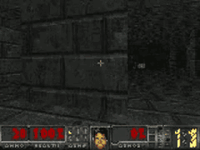
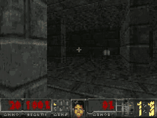
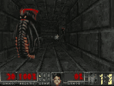

# DOOM / ViZDoom RL — architecture comparison

Reinforcement-learning agents for ViZDoom, and the evidence behind the claims made
about them. Two independent experiment campaigns are reported here, kept strictly
apart: a **single-GPU study** on one RTX 5090 (`FINAL_REPORT.md` in the private
research repo) and a **cluster campaign** of 245 runs on ctlab (`results/`).
They use different budgets, metrics and hardware, so their numbers are never
pooled, averaged or compared across tables.

Every number below names the file it came from. Anything I could not point at is
marked `[UNVERIFIED]` rather than quoted.

## Environment

All runs use ViZDoom's deathmatch arena `battle.cfg` through Sample Factory 2.1.1:
env id `doom_benchmark`, `Discrete(9)` actions (turn ×3, move ×3, strafe ×2,
attack), 160×120 Doom screen resized to 128×72 RGB, `env_frameskip=4`.

This is **one arena, one objective** — a deathmatch score, not level completion.
See [What this does not show](#what-this-does-not-show).

## Cluster campaign: 245 runs

Full tables, per-seed values and the log each row was parsed from:
**[`results/CLUSTER_RESULTS.md`](results/CLUSTER_RESULTS.md)**.
Raw per-run rows: [`results/runs.csv`](results/runs.csv).

Metric: `last20` = mean of the last 20 per-iteration Avg-episode-reward values
logged by Sample Factory, per run; `±` is the sample standard deviation across
seeds. Generated by [`scripts/agg_runs.py`](scripts/agg_runs.py) from
`train_dir/<run>/sf_log.txt` — the study kept no other per-run artifact
(`results_summary.json` was gitignored upstream and never committed).

### 50M env frames

| arm | per-seed last20 | n | mean ± s.d. | rnn | wall |
|---|---|---|---|---|---|
| `gru_hpov4` | 15.10 / 14.12 / 15.31 | 3 | **14.84 ± 0.64** | gru/512 | 0.8 h |
| `mamba3_large` | 13.89 / 13.48 / 16.07 | 3 | **14.48 ± 1.39** | mamba3/66688 | 1.3 h |
| `mamba3_hpov4` | 13.30 / 13.35 / 14.31 | 3 | **13.65 ± 0.57** | mamba3/16960 | 0.7 h |
| `gdn` | 14.67 / 17.31 / 11.04 / 12.63 / 9.76 | 5 | **13.08 ± 2.99** | gdn/73728 | 1.4 h |

### 250M env frames

| arm | per-seed last20 | n | mean ± s.d. | rnn | wall |
|---|---|---|---|---|---|
| `gru_baseline` | 24.57 | 1 | **24.57** | gru/512 | 4.3 h |
| `gru_v4_lr3` | 23.87 | 1 | **23.87** | gru/512 | 4.3 h |
| `mamba3_hpov4` | 20.08 / 18.58 / 17.29 | 3 | **18.65 ± 1.40** | mamba3/16960 | 3.4 h |
| `gdn` | 13.70 / 16.96 / 14.29 | 3 | **14.98 ± 1.74** | gdn/73728 | 7.0 h |

Two honest caveats, both visible in the table above:

- The 250M GRU row is **two single runs**, not seeds: `gru_baseline` and
  `gru_v4_lr3` differ only in learning rate. A third run of the same family,
  `gru_250m_v4`, **collapsed** (peaked at 16.54, ended 5.35) and is listed
  separately in `CLUSTER_RESULTS.md` with an asterisk. It is an LR instability,
  not a low-scoring sample — averaging it in would have produced a fake "GRU is
  unstable at 250M" claim.
- `mamba3_50m_m`, `mamba3_best_50m`, `mamba3_fixed_50m`, `mamba3_fixed_v2_50m`
  and `mamba3_50m_final` are single runs on different code states, kept out of the
  seed groups. The cluster checkout was dirty throughout (`git_hash` is `1fa02f7`
  for most runs, `fad9545` for the GDN runs), so the diff, not the hash, identifies
  what ran.

## Single-GPU study: 50M steps, RTX 5090

Source: `FINAL_REPORT.md` §1 of the research repo. Metric there is **best/final
mean episode reward** over per-iteration averages, which is *not* the `last20`
above — hence the separate table.

| Architecture | Seeds | Best | Final |
|---|---|---|---|
| GRU + HPO | 3 | 18.07 ± 2.08 | 17.66 ± 2.39 |
| Mamba-2 HPO | 4 | 15.46 ± 1.56 | 14.45 ± 2.20 |
| GRU baseline | 7 | 14.49 ± 0.63 | 13.68 ± 1.10 |
| Mamba-1 | 3 | 13.29 ± 0.14 | 9.03 ± 3.20 |
| GLA | 10 | 7.83 ± 2.40 | 6.57 ± 2.60 |
| Delta Net | 10 | 5.17 ± 2.46 | 4.17 ± 2.24 |
| Perceiver | 1 | 1.97 | 0.99 |
| Transformer | 1 | 1.01 | 0.57 |

The only statistically tested comparison in that report is GRU+HPO vs GRU
baseline: t = −4.107, p = 0.0034 (3 vs 7 seeds). Everything else is descriptive.

## What the two campaigns say together

- At 50M frames on the cluster, every arm is within ~1.8 reward of every other and
  the intervals overlap. **No architecture wins at this budget.**
- At 250M the GRU is ahead (24.2 over two healthy runs) while Mamba-3 is at
  18.65 ± 1.40 and GDN at 14.98 ± 1.74. The "SSMs win early, Transformers win
  late" story does not survive: the SSM advantage that appears at 50M in some
  single runs does not hold at 250M.
- GDN costs 2× the wall clock of the GRU for a lower score (7.0 h vs 4.3 h per
  250M run).
- The single-GPU study's GRU+HPO result (17.66 final) is **not** comparable to the
  cluster's 50M rows (metric differs), and must not be quoted as one.

## Released checkpoint

[`v1-gru-250m`](https://github.com/Kiraprint/DOOM-Mamba2-agent/releases/tag/v1-gru-250m)
is the best-scoring cluster run, published as an ordinary Sample Factory
experiment directory (`config.json` + `checkpoint_p0/*.pth`, 67 MB):

```bash
./scripts/install_checkpoint.sh                  # -> ./train_dir/gru_250m_baseline
EXPERIMENT=gru_250m_baseline ./scripts/eval_sf_checkpoint.sh
SAVE_VIDEO=1 NO_RENDER=1 ./scripts/eval_sf_checkpoint.sh   # record an episode
```

Sample Factory 2.1.1 + ViZDoom 1.3.0 on Linux. The eval script exports
`TORCH_FORCE_NO_WEIGHTS_ONLY_LOAD=1`: SF 2.1.1 calls `torch.load()` without
`weights_only`, and torch ≥ 2.6 then refuses this checkpoint inside a retry loop
that swallows the error, surfacing as `'NoneType' object is not subscriptable`.
One more gotcha, both hit while producing the gifs below: the script's
`TRAIN_DIR` is pinned to an absolute path (SF resolves checkpoints relative to
`cwd`), and `--save_video` shells out to a real `ffmpeg` binary.

Rollouts from this checkpoint — three separate episodes, unedited, slow enough to
read the HUD:

| episode reward | clip |
|---|---|
| 30.0 |  |
| 32.0 |  |
| 22.0 |  |

`train_dir/gru_250m_baseline/checkpoint_p0/` also contains
`best_000015260_250019840_reward_24.480.pth`, which is what the 24.57 row refers
to (Sample Factory's `save_best_metric` snapshot at 250M frames). Those three
episode rewards are single episodes on the training distribution, not a held-out
evaluation — the 24.57 `last20` figure is the one to compare against.

Reproducing the training run itself:

```bash
./scripts/sample_factory_train.sh doom_benchmark 250000000 \
  --use_rnn=True --rnn_size=512 --rnn_num_layers=1 \
  --batch_size=4096 --rollout=64 --recurrence=32 --gamma=0.99 \
  --env_frameskip=4 --res_w=128 --res_h=72
```

## What this does not show

- **One arena, one objective.** `doom_benchmark` = `battle.cfg` deathmatch. No
  level completion, no navigation, no exit. A high score here does not mean the
  agent can finish a Doom map; the levels live in a separate benchmark
  (`doom_sf/bench/` in DOOM-SF) that is not part of this result set.
- **Single-task, version-pinned.** ViZDoom 1.3.0 was what actually ran
  (`_vizdoom.ini` headers); the lock files in the two repos disagree (1.2.4 vs
  1.3.0). Numbers are not portable across ViZDoom versions.
- **Seeds are thin where it matters.** The 250M comparison is 1–3 seeds per arm,
  with one GRU configuration collapsed. No paired test is possible at n=1.
- **No held-out evaluation protocol.** `last20` is training-time reward over the
  same distribution the agent trained on; there is no separate eval seed set.
- **Job ids do not exist.** Every run was launched locally (no SLURM), so run
  identity is the experiment name plus the `sf_log.txt`/`config.json` in its
  directory, with `git_hash` and the per-run `git.diff` as code provenance.
- **The HPO trials are not published.** 125 trials (50 mamba3, 50 gru, 25 mamba2)
  at 10.03M frames exist only as run directories; `CLUSTER_RESULTS.md` counts them
  as excluded rather than reporting them.

## Repo layout

```
results/CLUSTER_RESULTS.md   generated tables: per-seed values, code identity, source log per row
results/runs.csv             one row per run: 242 rows, metrics + provenance + log path
scripts/agg_runs.py          regenerates both from train_dir/*/sf_log.txt
scripts/install_checkpoint.sh fetch the v1-gru-250m release into train_dir/
scripts/eval_sf_checkpoint.sh one-command eval / video capture for a released checkpoint
media/*.gif                  three recorded episodes (rewards 30.0 / 32.0 / 22.0)
scripts/sample_factory_train.sh, sample_factory_enjoy.sh   SF training / viewing
ppo_train.py, mamba_model.py, eval.py   standalone Mamba-2 PPO (separate from the SF campaign)
```

## Reproducing the tables

```bash
# point at a directory of Sample Factory runs (each with sf_log.txt)
python scripts/agg_runs.py --train-dir /path/to/train_dir \
    --csv results/runs.csv --md results/CLUSTER_RESULTS.md
```

The script exits nonzero if any run reaching 50M frames is missing from its
manifest, so a renamed run cannot silently drop a seed out of a table.

## References

- [Sample Factory VizDoom integration](https://www.samplefactory.dev/09-environment-integrations/vizdoom/)
- [SF2 ViZDoom battle report](https://wandb.ai/andrewzhang505/sample_factory/reports/VizDoom-Battle-Environments--VmlldzoyMzcyODQx)
- [ViZDoom](https://vizdoom.farama.org/)
